# Criterion

<p align="center">
  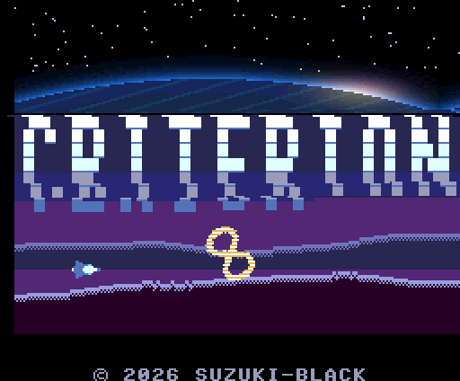
</p>

> ⚠️ **Work in progress.** Published for feedback and experimentation.
> **開発中の作品です。** フィードバックと実験のために公開しています。

A single-player, horizontally-scrolling shoot-'em-up for the **MSX turboR** (V9958 VDP · R800).
Every stage gets **one trick that no other stage uses**. Stage 1 draws an army of soldiers straight onto the
background. Stage 2 has a gravity well that bends the starfield. Stage 3 races down a corridor at 6 dots a
frame, stops dead and runs backwards. Stage 4 stacks up to twelve independently scrolling cloud layers.
Stage 5 is a battleship many screens long. Stage 6 splits the picture between SCREEN 12 and SCREEN 5. Stage 7
is a rush of every boss you have already beaten. All of it is one unbroken flight from the title screen to the
ending.

It is the successor to **[Shin Zero no Houkou](https://github.com/suzuki-black/ZeroNoHoukouR)** and takes that
engine sideways.

<table>
  <tr>
    <td>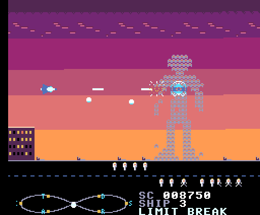<br><sub><b>1 TWILIGHT DESCENT</b> — LEGION, a giant built from machine soldiers drawn on the background</sub></td>
    <td>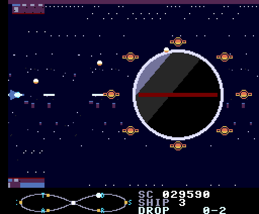<br><sub><b>2 GRAVITY WELL</b> — the starfield bends around KILOGRAM</sub></td>
  </tr>
  <tr>
    <td>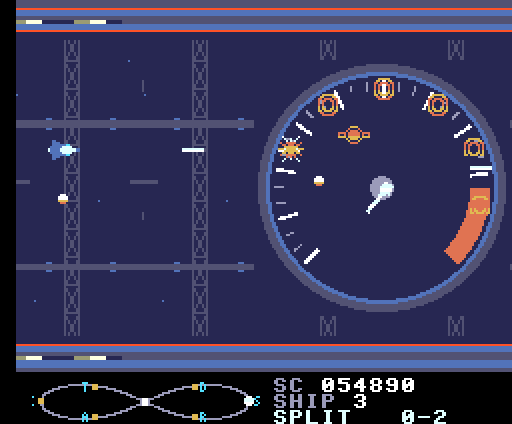<br><sub><b>3 OVERDRIVE CORRIDOR</b> — the TACHOMETER's needle sets the speed</sub></td>
    <td>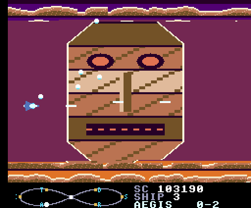<br><sub><b>4 STRATA</b> — a face assembled from six raster bands</sub></td>
  </tr>
  <tr>
    <td>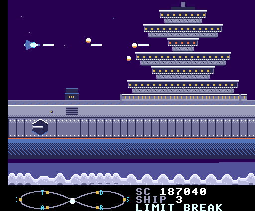<br><sub><b>5 DREADNOUGHT "NORM"</b> — over a battleship many screens long</sub></td>
    <td>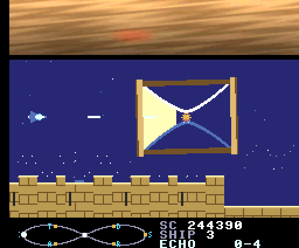<br><sub><b>6 GNOMON CITADEL</b> — SCREEN 12 sky above, SCREEN 5 below</sub></td>
  </tr>
  <tr>
    <td>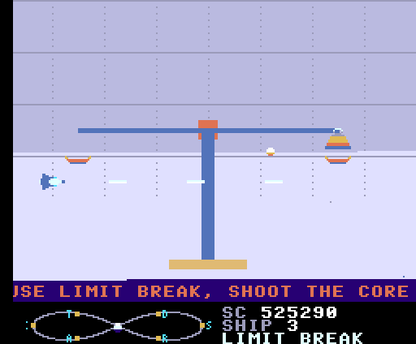<br><sub><b>7 CALIBRATION HALL</b> — LIBRA, after the boss rush</sub></td>
    <td>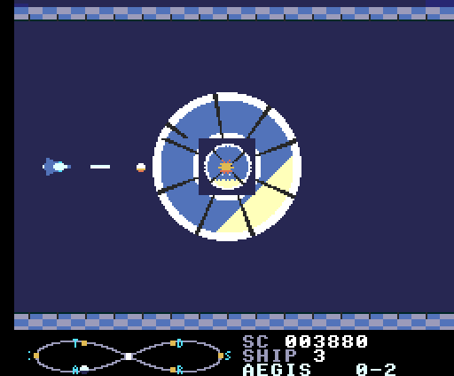<br><sub><b>8 THE PROTOTYPE</b> — the final boss's first form</sub></td>
  </tr>
</table>

**Language:** [🇬🇧 English](#english) · [🇯🇵 日本語](#japanese)

---

<a name="english"></a>
## English

- [Story](#story)
- [Overview](#overview)
- [Features](#features)
- [Stages](#stages)
- [Controls](#controls)
- [Requirements](#requirements)
- [Building](#building)
- [Running](#running)
- [Project structure](#project-structure)
- [Documentation](#documentation)
- [Scope & honest positioning](#scope--honest-positioning)
- [Feedback](#feedback--contributing)
- [Credits](#credits)
- [License](#license)
- [Disclaimer](#disclaimer)

### Story

> Year 2xxx. From beyond the stars, *it* came — to measure.
>
> It calls itself **Criterion**: a machine intelligence that believes it is the one absolute standard
> by which all things are judged. It travels the galaxy holding every civilisation it meets against its
> own scale. What fits is catalogued as *within tolerance*. What does not is *calibrated* — shaved away.
>
> Earth was judged **out of tolerance**.
>
> The **Terran Defense Force (TDF)** has one card left: a single prototype fighter, built so that none of
> its values can ever be pinned down. Its name is **Infinitas** — Latin for *infinity*.
> What cannot be measured cannot be judged.

### Overview
- **Platform:** MSX turboR (an 8 Mbit (1 MB) ASCII8 MegaROM). The engine assumes the R800.
- **Genre:** Single-player horizontal shoot-'em-up, running at 60 frames per second.
- **Structure:** 8 stages, an escape and an ending, then a second loop with re-calibrated bosses.
  - Each stage runs *dogfight → stage → mid-boss → stage → boss*.
  - There is no blackout and no "STAGE 2" screen between stages; you keep flying from one into the next.

### Features
- **One trick per stage** (see [Stages](#stages)). Stage 7 brings every boss back in a "re-calibrated" form.
- **The ∞ gauge (lemniscate gauge).** A figure-eight track on the HUD with seven nodes.
  - Each crystal (*Quanta*) you collect moves the cursor one node along the eight:
    `∞ → THRUST → ECHO → AEGIS → ∞ → DROP → SPLIT → RAY → ∞ …`.
  - Press B to take the node under the cursor.
  - The power-ups:
    - THRUST — speed, with an afterimage.
    - ECHO — options that trace your path and absorb one small bullet.
    - AEGIS — a front shield, then a rotating ring.
    - DROP — bombs that crawl along the ground.
    - SPLIT — 3-way / 5-way shot.
    - RAY — a piercing laser.
  - The centre node is **LIMIT BREAK**: a spinning ∞ shock wave that clears the screen and hits bosses hard.
    In exchange, every power-up except THRUST drops one level. The stage 7 finale is built around that trade-off.
- **Raster work everywhere:**
  - up to 12 bands, each with its own horizontal scroll and colour;
  - a heat-haze band that rewrites R#27 on every line;
  - R#23 vertical scroll inside a band;
  - partial sprite magnification;
  - the HUD as a fixed band at the bottom.
- **Screen-mode splits:** the title screen and stage 6 show a SCREEN 12 (YJK natural-colour) band above a
  SCREEN 5 play area.
- **Big moving pictures without a rotation routine per frame:**
  - the stage 2 boss and the stage 5 battleship approach from far away, frame by frame;
  - the stage 6 hourglass turns through 120 pre-drawn frames, written straight to VRAM.
- **ROTOR and GHOST:**
  - ROTOR is a rotate-and-scale routine, used for bosses and the title emblem.
  - GHOST is a queue of VDP copy commands that draws "software sprites" straight onto the background. Stage 1
    puts its marching machine soldiers there, independent of the sprite limit.
- **Sound:**
  - 24 original tracks for MSX-MUSIC (FM, six voices + rhythm) and PSG, plus sound effects;
  - turboR PCM for orchestra hits, an explosion and synthesized voice lines ("INFINITAS, LAUNCH",
    "WARNING" …), played during the game without stopping it.
- **Around the game:**
  - a boot logo;
  - a title where the logo slides together from eight raster bands;
  - attract-mode demos of stages 1, 3, 4 and 5;
  - a ranking table and name entry on a rotating dial;
  - a "rewind" back to the title.

<p align="center">
  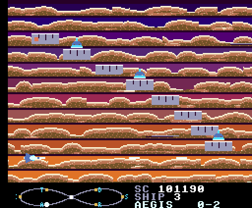
  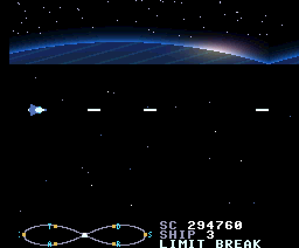
</p>

### Stages
| # | Title | The trick |
|---|---|---|
| 1 | TWILIGHT DESCENT | Machine soldiers (*Pawn*) drawn directly onto the background; the mid-boss LEGION is made of them |
| 2 | GRAVITY WELL | Gravity that changes direction, and a raster "gravity lens" around the boss KILOGRAM |
| 3 | OVERDRIVE CORRIDOR | Scroll speed as the star: acceleration, a dead stop, reverse running |
| 4 | STRATA | Multi-band raster scrolling: cloud layers flowing both ways, and a boss whose face is six bands |
| 5 | DREADNOUGHT "NORM" | A battleship many screens long: you fly above it, under it and through its engine room |
| 6 | GNOMON CITADEL | SCREEN 12 above, SCREEN 5 below; a sundial fortress |
| 7 | CALIBRATION HALL | Boss rush: the earlier bosses return re-calibrated, then the new boss LIBRA |
| 8 | THE PROTOTYPE | Everything at once, and a three-form final boss |

### Controls
| Input | Keyboard | Joystick |
|-------|----------|----------|
| Move | Arrow keys | Stick |
| A — fire (hold for auto-fire) | Space / Z | Trigger 1 |
| B — take the ∞ gauge node | X / M | Trigger 2 |

**Hidden settings menu.** On the title screen, press ↑↑↓↓←→←→ followed by keyboard **B**, **A**.
- It offers invincibility, the starting stage, a BGM / SE / PCM test and a VDP monitor.
- ↑/↓ choose an item, ←/→ change it, and Space plays a sound or leaves (EXIT).
- The starting stage applies to the first loop only; after the ending the second loop starts from stage 1.

### Requirements
- **Target hardware: MSX turboR only** (FS-A1ST / FS-A1GT). The engine assumes the R800 and turboR timing
  throughout.
- The turboR system ROM is copyrighted and is **not** included.
- Development and automated testing are done in [openMSX](https://openmsx.org/), with a machine built from a
  dumped turboR BIOS. On a C-BIOS machine the line interrupts the game runs on never fire.
- **Played on a real FS-A1ST** with the ROM loaded from an ESERAMair (a Wi-Fi RAM cartridge).
  - It plays from the title through the ending into the second loop.
  - openMSX does not match a real R800's speed exactly, so the timing margins measured there are estimates.
  - The FS-A1GT has not been tried.

### Building
Requires:
- [SDCC](https://sdcc.sourceforge.net/) 4.6 (`sdcc -mz80` and `sdasz80`);
- Node.js;
- Python 3 with Pillow.

The test scripts also need openMSX.

```bash
make
```

This produces `GAME.ROM` (an 8 Mbit (1 MB) ASCII8 MegaROM) and the technical-test ROMs `build/m0_*.rom`.
`make FPSMON=1` adds a frame-rate monitor to the HUD.

### Running
Under openMSX, with a turboR machine. `Panasonic_FS-A1ST` or `Panasonic_FS-A1GT` work, and they need their
system ROMs:

```bash
openmsx -machine Panasonic_FS-A1ST -carta GAME.ROM -romtype ASCII8
```

On a real turboR you need a way to load a 1 MB ASCII8 MegaROM image, such as a RAM cartridge.

### Project structure
```
src/core/      engine: VDP, raster interrupts, PCM, sprites, ROTOR / GHOST, frame timing, input, font
src/game/      main loop, stage engine (display ring, columns, raster list), player, enemies, sound driver
src/ovl/       per-scene overlays loaded into RAM (title, stages 1–8, ending)
src/bank/      second bank (weapons, small enemies, ∞ gauge effects)
src/bank3/     third bank (HUD drawing)
src/bank4/     fourth bank (music selection, far scenery, the stage 5 approach, stage 1 picture generation)
src/m0/        the M0 technical-test ROMs
src/include/   headers
tools/         asset generators (gen_*.py), music (songs.py), PCM (snd_pcm.py), ROM packer (rompack.mjs),
               test/ (openMSX test harnesses, run_game_m1..m7.sh)
assets/pcm/    CC0 source recordings for the PCM samples
docs/          design spec and development notes
```

### Documentation
- **[Design spec / 指示書](docs/指示書.md)** — the original design: story, the ∞ gauge, every stage, sound,
  technical targets.
- **[Differences from the spec / 指示書との差分](docs/指示書との差分_2026-10-07.md)** — what was built
  differently, and why.
- **Milestone notes:**
  - [M0 technical tests](docs/M0_技術検証.md)
  - [M1 horizontal engine](docs/M1_横エンジン基盤.md)
  - [M2 stage 1](docs/M2_縦切り1面.md)
  - [M3 ROTOR / GHOST](docs/M3_ROTOR_GHOST.md)
  - [M4 gravity, speed, multi-band raster](docs/M4_重力_高速_多段ラスター.md)
  - [M5 battleship, mode split](docs/M5_巨大戦艦_モード分割.md)
  - [M6 final stage, ending](docs/M6_最終面_エンディング.md)
  - [M7 sound](docs/M7_サウンド.md)
- **[TODO](docs/TODO.md)** — known issues left for later.
- **[CHANGELOG](CHANGELOG.md)**.

### Scope & honest positioning
- **The point is the turboR spectacle, not balance.** Each stage exists to show one thing the R800 and the
  V9958 can do. The only promise on difficulty is that one loop can be cleared.
- **It is still in development.** Some effects are simpler than the design spec (see the differences note).
- The aim is to get a little closer to the feel of late-1980s MSX shooters on a machine that came after them.
  It is not meant to compete with them.

### Feedback & Contributing
This is an experimental work released for feedback. Please use GitHub Issues to report bugs or share
impressions. Pull requests are welcome for clearly scoped fixes.

### Credits
- **Original Concept / Direction:** suzuki-black
- **Program / Graphics:** Claude Code (Anthropic Claude)
- **Sound (music, SFX, synthesized voices):** Claude Code (Anthropic Claude). All of it is original and copied
  from no existing work.
- **PCM source recordings:** all [CC0 1.0](https://creativecommons.org/publicdomain/zero/1.0/), from Freesound;
  details are in [assets/pcm/LICENSE.md](assets/pcm/LICENSE.md).
  - orchestra hit — BigDumbWeirdo
  - snare — KEVOY
  - explosion — SamsterBirdies

### License
**MIT** © 2026 suzuki-black. See [LICENSE](LICENSE).
- The code, graphics and music in this repository are released under the MIT license.
- The PCM source recordings in `assets/pcm/` are CC0 1.0 works by their authors.

### Disclaimer
Criterion is an original work. It is not affiliated with any existing game, company or organisation, and it
uses no names, characters, graphics, music or sound from other games.

---

<a name="japanese"></a>
## 日本語

- [あらすじ](#あらすじ)
- [概要](#概要)
- [特徴](#特徴)
- [ステージ](#ステージ)
- [操作](#操作)
- [動作環境](#動作環境)
- [ビルド](#ビルド)
- [実行](#実行)
- [ディレクトリ構成](#ディレクトリ構成)
- [ドキュメント](#ドキュメント)
- [位置づけ](#位置づけ正直な自己評価)
- [フィードバック](#フィードバック)
- [クレジット](#クレジット)
- [ライセンス](#ライセンス)
- [免責](#免責)

### あらすじ

> 西暦 2xxx 年。外宇宙から、それは「測りに」来た。
>
> 自らを **Criterion（クライテリオン）** と名乗るその存在は、物事を判断するための唯一絶対の尺度を自負する
> 機械知性だった。彼らは銀河を巡り、出会った文明を自らの目盛りに当てて測る。基準に収まるものは「規格内」として
> 標本化され、収まらないものは「規格外」として**校正**——すなわち削り取られる。
>
> 地球文明に下された判定は「規格外」。
>
> 地球防衛軍（**TDF / Terran Defense Force**）に残された最後の手段は、ただ一機の試作戦闘機だった。
> あらゆる計測値を意図的に“確定させない”よう設計された、測定不能の機体。その名は **Infinitas（インフィニタス）**
> ——ラテン語で「無限」。測れないものは、裁けない。

### 概要
- **対応機種:** MSX turboR 用ソフト（8 メガビット（1MB）の ASCII8 メガROM）。R800 を前提に設計しています。
- **ジャンル:** 1 人用・横スクロールシューティング。毎秒 60 フレームで動きます。
- **構成:** 全 8 面、脱出とエンディングのあと、ボスが再校正された 2 周目へ進みます。
  - 各面は「空中戦 → 本体 → 中ボス → 本体 → ボス」の順です。
  - 面と面のあいだに暗転も「STAGE 2」だけの画面もなく、飛び続けたまま次の面へつながります。
- 『[真 零の咆哮](https://github.com/suzuki-black/ZeroNoHoukouR)』のエンジンと知見を横スクロールへ発展させた後継作です。
  **「一面一芸」**として、各面にその面でしか見せない主役の技を一つずつ置いています。

### 特徴
- **一面一芸**（下の「ステージ」）。7 面では過去のボスが「再校正版」として次々に再登場します。
- **∞ゲージ（レムニスケート・ゲージ）**。HUD に 8 の字の軌道と 7 つのノードがあります。
  - 結晶 **Quanta** を取るたびに、カーソルが 8 の字をなぞって一つ進みます
    （`∞ → THRUST → ECHO → AEGIS → ∞ → DROP → SPLIT → RAY → ∞ …`）。
  - B でカーソルのノードを確定します。
  - 強化の中身:
    - THRUST: 速度。残像が伸びる。
    - ECHO: 軌跡をなぞる分身。小さな敵弾を 1 発吸う。
    - AEGIS: 前面の防壁。次の段で回る輪になる。
    - DROP: 地形を這う爆雷。
    - SPLIT: 3WAY / 5WAY。
    - RAY: 貫通レーザー。
  - 中心は **LIMIT BREAK** です。回転する∞の衝撃波で画面を払い、ボスにも大きく効きます。引き換えに、THRUST 以外の
    強化が 1 段ずつ下がります。7 面の最終試験はこの駆け引きを軸にしています。
- **ラスターを全面で**:
  - 横スクロールと色を独立に持つ最大 12 本の帯
  - 毎ライン R#27 を書き換える陽炎帯
  - 帯の中の R#23 縦スクロール
  - 部分的なスプライト拡大
  - 画面下の固定 HUD 帯
- **画面モードの分割**: タイトルと 6 面は、上が SCREEN 12（YJK 自然画）、下が SCREEN 5 のプレイエリアです。
- **大きな絵を毎フレームの回転なしで動かす**:
  - 2 面のボスと 5 面の戦艦は、遠くから 1 段ずつ近づいてきます。
  - 6 面の砂時計は、あらかじめ描いた 120 コマを VRAM へ直に書いて回します。
- **ROTOR と GHOST**:
  - ROTOR は、ボスやタイトルの紋章を回す回転拡縮です。
  - GHOST は、VDP のコピー命令の待ち行列で背景に直接描くソフトウェアスプライトです。1 面の行進する機械兵は、
    スプライトの枚数制限と無関係に BG に描いています。
- **音**:
  - MSX-MUSIC（FM 6 声＋リズム）と PSG のオリジナル曲 24 曲、効果音
  - turboR の PCM（オーケストラヒット・爆発・合成音声「INFINITAS, LAUNCH」「WARNING」など）。PCM はゲームを止めずに鳴らします。
- **ゲームの周り**:
  - 起動ロゴ
  - 8 本のラスター帯からロゴが組み上がるタイトル
  - 1・3・4・5 面のデモ
  - ランキングと、回転する文字盤のネームエントリー
  - タイトルへの「巻き戻し」

### ステージ
| 面 | タイトル | 主役の技 |
|---|---|---|
| 1 | 黄昏の降下 / TWILIGHT DESCENT | 背景に直接描く機械兵 *Pawn* の群れ。中ボス LEGION はその集合体 |
| 2 | 重力井戸 / GRAVITY WELL | 向きの変わる重力と、ボス KILOGRAM の周りのラスターによる「重力レンズ」 |
| 3 | 臨界加速 / OVERDRIVE CORRIDOR | スクロール速度そのものが主役: 加速、急停止、逆走 |
| 4 | 層流 / STRATA | 多段ラスタースクロール: 逆向きにも流れる雲の層と、6 本の帯で顔が組み上がるボス |
| 5 | 規格戦艦ノルム / DREADNOUGHT "NORM" | 何画面にもわたる巨大戦艦の上・下・機関部を飛ぶ |
| 6 | 日時計要塞 / GNOMON CITADEL | 上が SCREEN 12、下が SCREEN 5 の画面分割。日時計の要塞 |
| 7 | 校正室 / CALIBRATION HALL | ボスオンパレード: 過去のボスの再校正版、そして新しいボス LIBRA |
| 8 | 原器 / THE PROTOTYPE | 全技術の総動員と、3 形態のラスボス |

### 操作
| 入力 | キーボード | ジョイスティック |
|------|-----------|-----------------|
| 移動 | カーソルキー | 方向 |
| A: ショット（押しっぱなしで連射） | スペース / Z | トリガ 1 |
| B: ∞ゲージのノードを確定 | X / M | トリガ 2 |

**隠しの設定.** タイトルで ↑↑↓↓←→←→ に続けてキーボードの **B**、**A** を押すと入れます。
- 無敵・始める面・BGM / 効果音 / PCM の試聴・VDP モニターがあります。
- 上下で項目、左右で値を選び、スペースで鳴らします。EXIT で抜けます。
- 始める面は 1 周目にだけ効きます。エンディングのあとの 2 周目は 1 面から始まります。

### 動作環境
- **MSX turboR 専用**（FS-A1ST / FS-A1GT）。R800 と turboR のタイミングを前提に組んでいます。
- turboR 本体 ROM は著作物のため**同梱していません**。
- 開発と自動テストは [openMSX](https://openmsx.org/) で、**実機 BIOS を吸い出した機種定義**を使って行っています。
  C-BIOS の機械では、ゲームが頼っている走査線割込みが発火しません。
- **実機の FS-A1ST で遊べることを確かめています。** ROM は ESERAMair（Wi-Fi 付きの RAM カートリッジ）から載せました。
  - タイトルからエンディング、2 周目まで遊べます。
  - openMSX の R800 の速さは実機と完全には一致しないので、openMSX で測った処理の余裕は目安です。
  - FS-A1GT では試していません。

### ビルド
必要なもの:
- [SDCC](https://sdcc.sourceforge.net/) 4.6（`sdcc -mz80` と `sdasz80`）
- Node.js
- Python 3（Pillow）

検証スクリプトには openMSX も使います。

```bash
make
```

`GAME.ROM`（8 メガビット（1MB）の ASCII8 メガROM）と、技術検証用の `build/m0_*.rom` が生成されます。
`make FPSMON=1` で、HUD に実効のフレーム数を出す版を作れます。

### 実行
openMSX では turboR の機種（`Panasonic_FS-A1ST` や `Panasonic_FS-A1GT`。本体 ROM が必要）で動かします:

```bash
openmsx -machine Panasonic_FS-A1ST -carta GAME.ROM -romtype ASCII8
```

実機の turboR で動かすには、RAM カートリッジなど、1MB の ASCII8 メガROM イメージを読み込める手段が必要です。

### ディレクトリ構成
```
src/core/      エンジン: VDP、走査線割込み、PCM、スプライト、ROTOR / GHOST、フレームの時刻、入力、フォント
src/game/      メインループ、面のエンジン(表示リング・列・ラスターリスト)、自機、敵、音のドライバ
src/ovl/       場面ごとに RAM へ読み込むオーバレイ(タイトル、1〜8 面、エンディング)
src/bank/      第 2 バンク(武器、雑魚、∞ゲージの演出)
src/bank3/     第 3 バンク(HUD の表示)
src/bank4/     第 4 バンク(選曲、遠景、5 面の接近、1 面の絵作り)
src/m0/        M0 の技術検証 ROM
src/include/   ヘッダ
tools/         素材の生成(gen_*.py)、曲(songs.py)、PCM(snd_pcm.py)、ROM の組み立て(rompack.mjs)、
               test/(openMSX の検証スクリプト run_game_m1..m7.sh)
assets/pcm/    PCM の元にした CC0 の録音
docs/          指示書と開発ノート
```

### ドキュメント
- **[指示書](docs/指示書.md)**: 最初の設計。物語、∞ゲージ、全 8 面、音、技術目標。
- **[指示書との差分](docs/指示書との差分_2026-10-07.md)**: 指示書と違う作りにしたところと、その理由。
- **マイルストーンごとのノート**:
  - [M0 技術検証](docs/M0_技術検証.md)
  - [M1 横エンジン基盤](docs/M1_横エンジン基盤.md)
  - [M2 縦切り 1 面](docs/M2_縦切り1面.md)
  - [M3 ROTOR / GHOST](docs/M3_ROTOR_GHOST.md)
  - [M4 重力・高速・多段ラスター](docs/M4_重力_高速_多段ラスター.md)
  - [M5 巨大戦艦・モード分割](docs/M5_巨大戦艦_モード分割.md)
  - [M6 最終面・エンディング](docs/M6_最終面_エンディング.md)
  - [M7 サウンド](docs/M7_サウンド.md)
- **[TODO](docs/TODO.md)**: 後回しにした点。
- **[CHANGELOG](CHANGELOG.md)**。

### 位置づけ（正直な自己評価）
- **主題は turboR の見せ場で、バランスは二の次**です。各面は R800 と V9958 にできることを一つ見せるためにあります。
  難しさについて約束しているのは「1 周クリアできること」だけです。
- **まだ開発中**です。指示書より簡単にした演出があります（「指示書との差分」を参照）。
- 1980 年代後半の MSX のシューティングの手触りに、後から出た機械で少しでも近づけたら、という試みです。
  それらと競うものではありません。

### フィードバック
本作はフィードバックのために公開している実験的な作品です。不具合報告や感想は GitHub Issues でお願いします。
範囲の明確な修正の Pull Request も歓迎します。

### クレジット
- **原案・ディレクション:** suzuki-black
- **プログラム／グラフィック:** Claude Code（Anthropic Claude）
- **サウンド（BGM・効果音・合成音声）:** Claude Code（Anthropic Claude）。すべてオリジナルで、既存楽曲のコピーではありません。
- **PCM の元にした録音:** いずれも Freesound の [CC0 1.0](https://creativecommons.org/publicdomain/zero/1.0/deed.ja) です。
  詳細は [assets/pcm/LICENSE.md](assets/pcm/LICENSE.md) にあります。
  - オーケストラヒット: BigDumbWeirdo
  - スネア: KEVOY
  - 爆発: SamsterBirdies

### ライセンス
**MIT** © 2026 suzuki-black。詳細は [LICENSE](LICENSE) を参照してください。
- 本リポジトリのコード・グラフィック・音楽は MIT ライセンスで公開します。
- `assets/pcm/` の元の録音は、それぞれの作者による CC0 1.0 の作品です。

### 免責
本作はオリジナル作品です。実在のゲーム・企業・団体とは関係がなく、他のゲームの名称・キャラクター・
グラフィック・音楽・効果音は使用していません。
